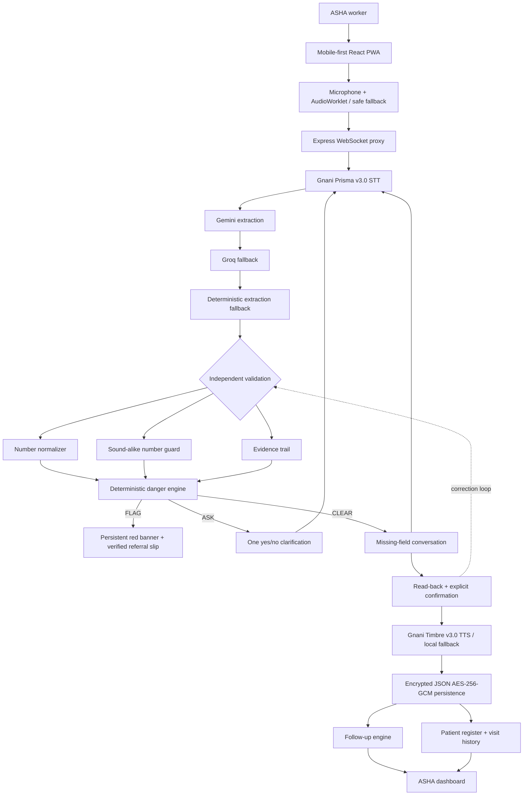

# Overall system architecture

The deployed repository uses TypeScript/React/Vite, an Express/WS server, JSON persistence encrypted with AES-256-GCM, Gnani Prisma/Timbre, Gemini/Groq fallback extraction, and deterministic safety rules.
